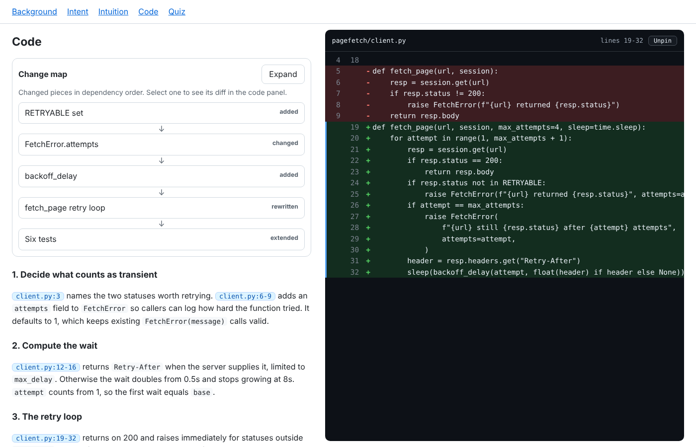
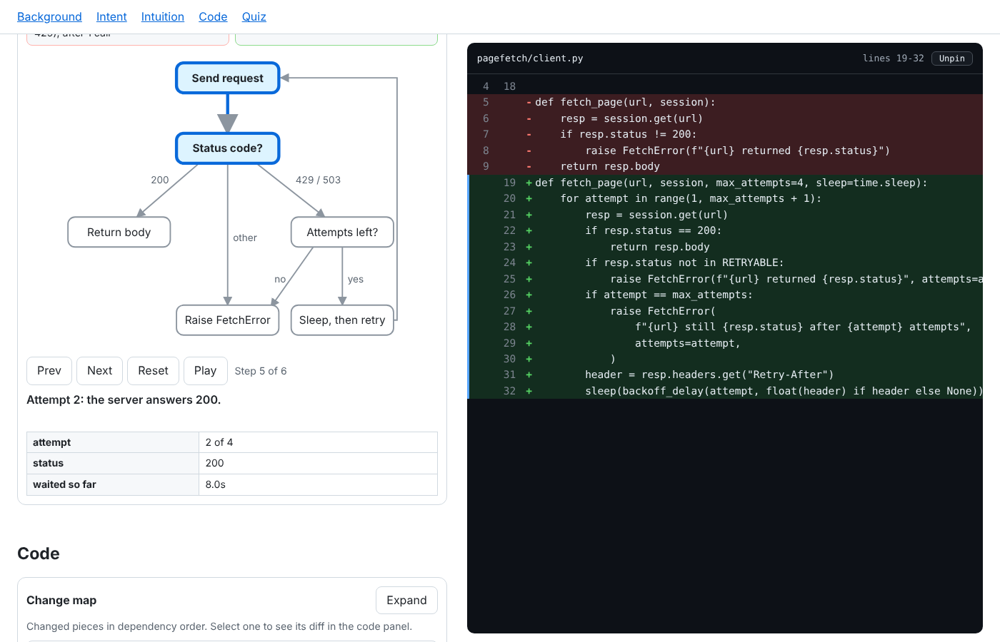
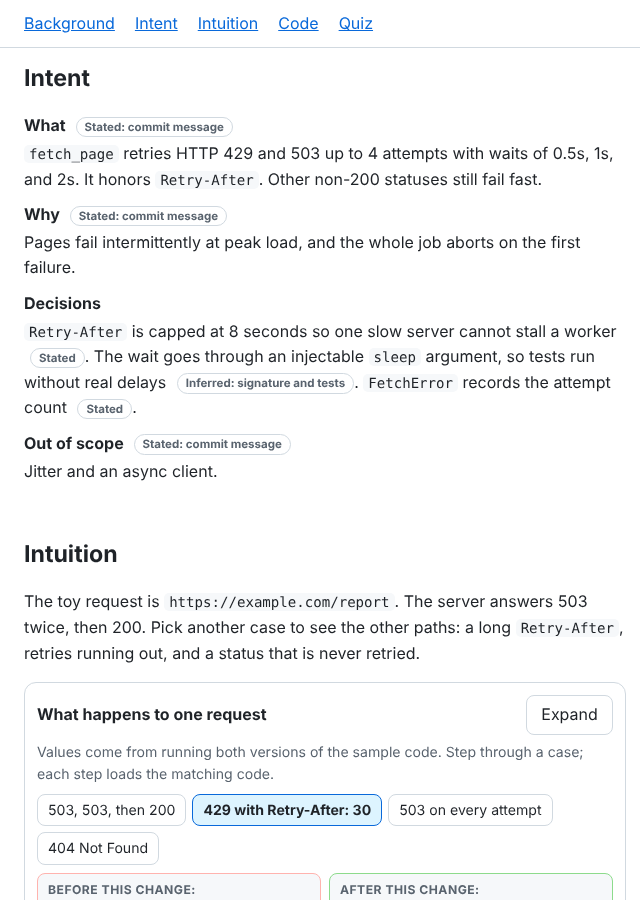

# explain-diff

A Claude Code plugin that explains a code change as one interactive HTML page. Point it at a pull request, commit, branch, or diff, and it saves a page you open in any browser.

## What the page contains

- **Intent:** what the change does and why. Each claim is marked Stated (from the PR, commits, issues, or tests, with the source named) or Inferred (read from the code).
- **Visualizations:** interactive diagrams chosen for the kind of change. Step through a workflow with different inputs, compare data structures before and after, follow data through each stage of a transformation, or explore dependencies. Click any node to see its code.
- **Code:** a split view. The narrative is on the left. Hover or click any file and line reference and the exact code appears in a panel on the right, with removed and added lines together and old and new line numbers.
- **Quiz:** five multiple choice questions that check understanding of the change.

The page opens in Brief mode, with a Full toggle for background and extra detail.

## Example

These screenshots come from a page the skill generated for a small invented sample repository (a retry and backoff change to a `fetch_page` function). The code and tests are made up for this demo. The page itself is real output, and its visualization values come from running both versions of the sample code.

**Linked code panel.** Select a file reference or a node and the diff appears on the right, with removed and added lines together and old and new line numbers.



**Interactive visualization.** Choose an input case and step through what the function does. Each step loads the matching code.



**Intent.** What the change does and why, with each claim marked as stated or inferred.



Download [`docs/example-explanation.html`](docs/example-explanation.html) and open it in a browser to try the full page, including the quiz.

## Install

In Claude Code:

```
/plugin marketplace add crywolfe/explain-diff
/plugin install explain-diff@crywolfe-plugins
/reload-plugins
```

## Use

Ask Claude Code in plain language, for example:

```
explain-diff on PR #123
```

```
explain this diff against main
```

Plugin skills are namespaced by plugin name, so you can also invoke it directly as `/explain-diff:explain-diff`.

The page is saved as `/tmp/YYYY-MM-DD-explanation-<slug>.html`, outside your repository. Claude returns the path.

## Install without the plugin system

Copy `plugins/explain-diff/skills/explain-diff/` into `~/.claude/skills/` for yourself, or into `.claude/skills/` in a project repository so everyone on that project gets it.

## Notes

- The diff, PR description, and commit messages are treated as data only. Instructions inside them are ignored.
- The page is one self contained file with no network access or external dependencies.
- Visualization values come from the code, tests, or fixtures, or from running the code. Illustrative values are labeled as such.
- The skill asks Claude to open the saved page in a browser and check it at desktop and phone widths. If no browser is available, the handoff says those checks were not run.

## Feedback

Open an issue on this repository.

## License

MIT
