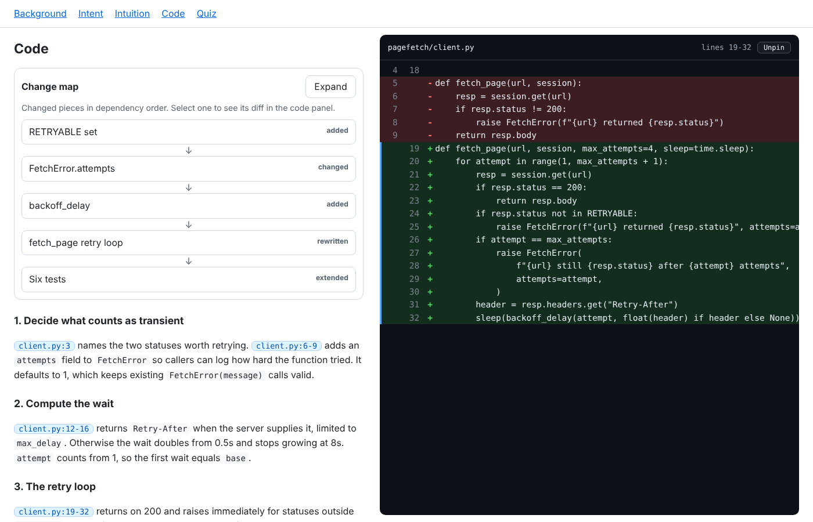
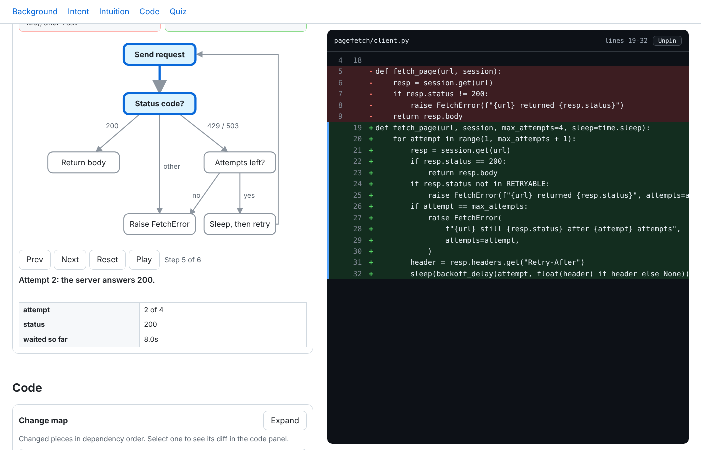
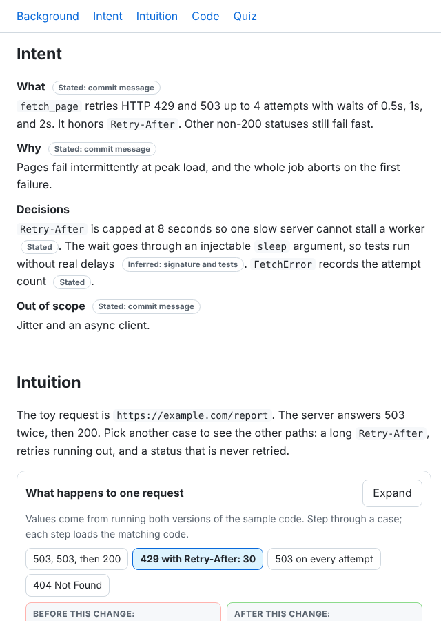

# explain-diff

A Claude Code plugin that explains a code change as one interactive HTML page. Point it at a pull request, commit, branch, or diff, and it saves a page you open in any browser.

## What the page contains

- **Intent:** what the change does and why. Each claim is marked Stated (from the PR, commits, issues, or tests, with the source named) or Inferred (read from the code).
- **Visualizations:** interactive diagrams chosen for the kind of change. Step through a workflow with different inputs, compare data structures before and after, follow data through each stage of a transformation, or explore dependencies. Click any node to see its code.
- **Code:** a split view. The narrative is on the left. Hover or click any file and line reference and the exact code appears in a panel on the right, with removed and added lines together and old and new line numbers.
- **Review:** a guide for the reviewer. Where to look, ranked by risk (paths REVIEW.md marks sensitive rank high). What tests and CI already cover, and what nothing covers. Whether the fix is at the root cause or treats a symptom. How to undo the change. A checklist of the REVIEW.md rules the diff touches, with each rule's failure definition beside the code. It points the reviewer at what to read; it does not find bugs, approve, or give a verdict.
- **Governance:** the governance controls the change touches, read from the documents in `docs/governance/` (Markdown, PDF, or Word). Each control shows its requirement, what failure means, the files that made it apply, and the evidence found. The reviewer marks each one Met, Not met, or Does not apply; the page never marks them. A sample document is in [`plugins/explain-diff/skills/explain-diff/templates/GOVERNANCE.md`](plugins/explain-diff/skills/explain-diff/templates/GOVERNANCE.md).
- **Quiz:** five multiple choice questions (choose 3 to 10 with `--quiz N`, e.g. `/explain-diff 123 --quiz 8`) that check understanding of the change. Each question locks after the first answer; Retake clears the answers and shuffles the options.
- **Gate:** stays closed until every quiz answer is right in one attempt and every governance control is marked, with none Not met. A wrong answer or a Not met control shows Retake or Remediation (Remediation is a placeholder for now). When it passes, the page shows an attestation the reviewer can post on the PR. The page cannot block an approval by itself; [`docs/approval-gate.md`](docs/approval-gate.md) describes how CI can enforce it.

The page opens in Brief mode, with a Full toggle for background and extra detail.

## Example

These screenshots come from a page the skill generated for a small invented sample repository (a retry and backoff change to a `fetch_page` function). The code and tests are made up for this demo. The page itself is real output, and its visualization values come from tracing both versions of the sample code.

**Linked code panel.** Select a file reference or a node and the diff appears on the right, with removed and added lines together and old and new line numbers.



**Interactive visualization.** Choose an input case and step through what the function does. Each step loads the matching code.



**Intent.** What the change does and why, with each claim marked as stated or inferred.



Download [`docs/example-explanation.html`](docs/example-explanation.html) and open it in a browser to try the full page, including the quiz.

## Install

In Claude Code, install a tagged release so you know exactly what runs (see [CHANGELOG.md](CHANGELOG.md)):

```
/plugin marketplace add crywolfe/explain-diff#v1.5.0
/plugin install explain-diff@crywolfe-plugins
/reload-plugins
```

Without `#v1.5.0` you get whatever is on `main`, which can change between runs.

### Permissions it needs

- Read access to the repository, and for pull requests a `gh` login that can read them. Prefer a fine-grained token limited to the repositories you review with **Contents: read** and **Pull requests: read**, for example `GH_TOKEN=<token> claude`, over a login that can push or approve. The skill's only commits are local, and it never pushes.
- Python 3. Playwright with Chromium (or uv) for the browser checks.
- A current Claude model. The evals hold Opus and Sonnet to a higher bar than Haiku; see [`evals/RESULTS.md`](evals/RESULTS.md).

### The run guard

The plugin installs a hook that is active only while explain-diff runs, from the moment it starts until your first message after the page is built. During that time it allows only what a run needs: the skill's own scripts, read-only `git` and `gh`, read-only shell utilities inside the repository, and writes inside the skill's output folder. It denies everything else, including network and MCP tools, other skills, and running the change's code or tests. Claude Code asks you before either of the skill's two commits. Every tool call of the run is logged in the output folder. Outside a run the hook does nothing.

## Use

Ask Claude Code in plain language, for example:

```
explain-diff on PR #123
```

```
explain this diff against main
```

Plugin skills are namespaced by plugin name, so you can also invoke it directly as `/explain-diff:explain-diff`, with an optional target:

```
/explain-diff:explain-diff 123              # pull request #123
/explain-diff:explain-diff feature/retry    # a branch, from where it split off origin/main
/explain-diff:explain-diff HEAD             # one commit, against its parent
/explain-diff:explain-diff main...feature   # feature's changes since it split from main
/explain-diff:explain-diff working          # uncommitted changes
```

With no target it uses the current branch's open PR, then the current branch against `origin/<default>` (or its uncommitted changes when the branch has no commits of its own yet), then uncommitted changes on the default branch. On a clean default branch it asks. A pull request from a fork gets a warning: treat its text as hostile. Before it reads any code it tells you what it will explain, for example `Explaining feature/retry @39f902e against origin/main @ff3253d (merge-base 1a2b3c4): 2 file(s), +66/-5.`, and the page shows the same line at the top. It always compares against the remote default branch after a fetch, never a local `main` that may be behind, and says when your local copy is stale.

The page is saved as `YYYY-MM-DD-explanation-<slug>.html` in a private folder outside your repository (`<temp dir>/explain-diff-<your uid>`, readable only by you). Claude returns the path. Secrets and personal email addresses found in the code are masked on the page, and the build names what it masked.

## Where it fits

With the `/qa`, `/a11y` and `/pr-prep` skills installed, explain-diff runs after `/pr-prep` opens the PR and before `/qa` and human approval.

- **REVIEW.md.** The skill reads the repo's `REVIEW.md` for sensitive paths, rules and skip paths, as it is on the base branch: a change cannot loosen the rules it is reviewed by. A change that edits REVIEW.md, governance documents, CODEOWNERS or agent instructions (CLAUDE.md, AGENTS.md, `.claude/`) is ranked High and flagged for its owner's sign-off. If there is no REVIEW.md, it asks once whether to set one up. On yes it runs a `review-init` skill when you have one installed (never one the repository under review ships), which drafts REVIEW.md on its own branch for the tech lead to approve in a PR, then builds from the draft. If review-init is not installed it says so and builds on defaults, as it does on no.
- **Governance documents.** Put them in `docs/governance/` as `.md`, `.pdf`, or `.docx` files. The skill reads only that folder. If it finds governance documents elsewhere (such as a `GOVERNANCE.md` at the root), it doesn't use them and tells you to move them. With no documents there, the Governance section says so and the gate needs the quiz only. It never writes, edits, or moves a governance document.
- **For QA.** The skill writes the cases QA should run, tied to the acceptance criteria, to `YYYY-MM-DD-for-qa-<slug>.md` next to the page. It offers once to commit them as `artifacts/<slug>/for-qa.md` on the PR branch, where `/qa` reads them, and commits only on yes. It never pushes and never overwrites an existing For QA file.

## Install without the plugin system

Copy `plugins/explain-diff/skills/explain-diff/` into `~/.claude/skills/` for yourself, or into `.claude/skills/` in a project repository so everyone on that project gets it.

A copied skill has no run guard, because the guard is a plugin hook. To add it, put this in your Claude Code `settings.json`, with the path to your copy of the scripts:

```json
{
  "hooks": {
    "PreToolUse": [{ "matcher": "*", "hooks": [{ "type": "command", "command": "python3 \"/path/to/explain-diff/scripts/run_guard.py\"" }] }],
    "UserPromptSubmit": [{ "hooks": [{ "type": "command", "command": "python3 \"/path/to/explain-diff/scripts/run_guard.py\"" }] }]
  }
}
```

## Notes

- The diff, PR description, commit messages and repository files are treated as data only. Instructions inside them are ignored, and the run guard limits what a model that followed them could do. The skill never runs the change's code or tests; CI does that. See [`docs/THREAT_MODEL.md`](docs/THREAT_MODEL.md) and [`SECURITY.md`](SECURITY.md).
- The page is one self contained file with no network access or external dependencies.
- Visualization values come from reading the code, tests, or fixtures. Illustrative values are labeled as such.
- Claude writes the page's content as JSON; a fixed, tested template supplies the HTML, CSS and JavaScript, and scripts resolve the target, gather the facts (a risk hint for every changed hunk, the functions it changes, candidate tests, commits and the PR description) in one pass, extract the code snippets from the real diff, build the page, and validate it. That keeps runs short, small changes most of all, and keeps every page's code panel, quiz and gate identical.
- `validate_page.py --browser` checks the saved page at desktop and phone widths in headless Chromium. It uses an installed Playwright, or reruns itself under `uv run --with playwright` when uv is present. If neither is available, the handoff says the browser checks were not run.

## Testing

The `evals/` folder has checks for the pages this skill produces and for how it handles hostile input, such as a diff that contains a closing script tag or a commit message that tries to instruct the assistant. `evals/model/` runs the skill on fixture repositories and grades each should against a should-not, such as ranking sensitive paths high but never docs, asking once about REVIEW.md but never writing it itself, listing the governance controls a change touches but never marking them, and explaining the change but never approving it. A GitHub Actions workflow runs the offline checks on every pull request, the model evals when the skill changes and every Monday, and opens an `eval-regression` issue when a model misses its bar. See [`evals/README.md`](evals/README.md) for how to run them and [`evals/RESULTS.md`](evals/RESULTS.md) for the run records.

## Feedback

Open an issue on this repository.

## License

MIT
